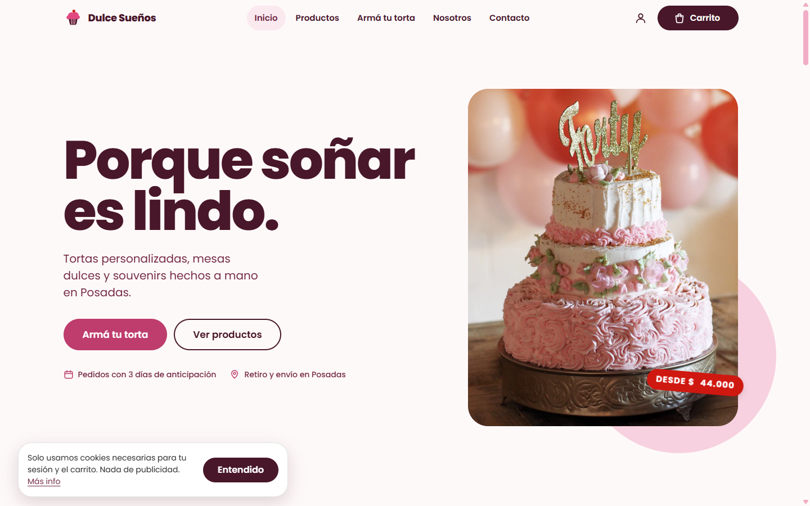
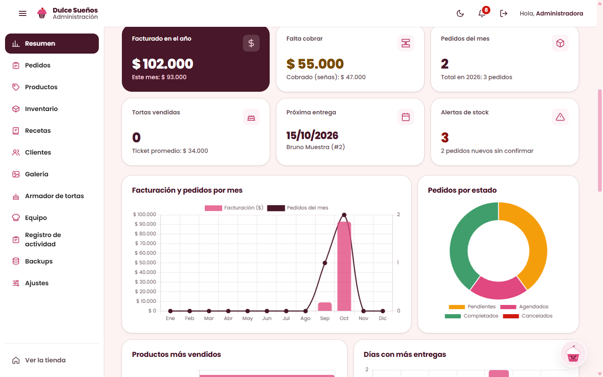
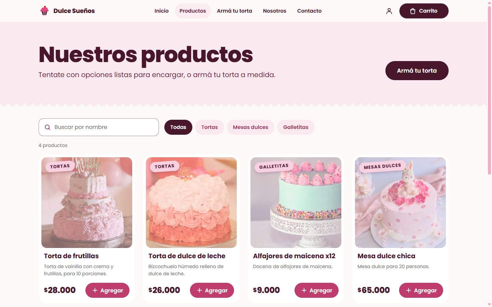
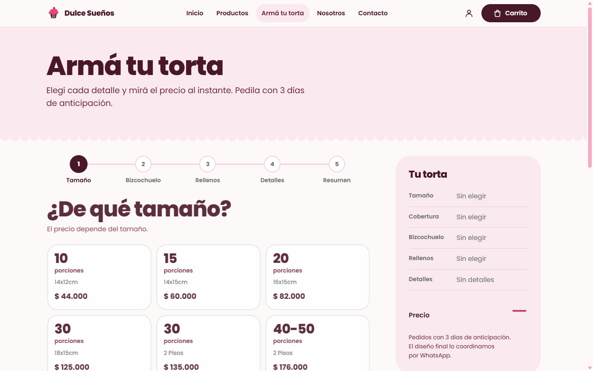
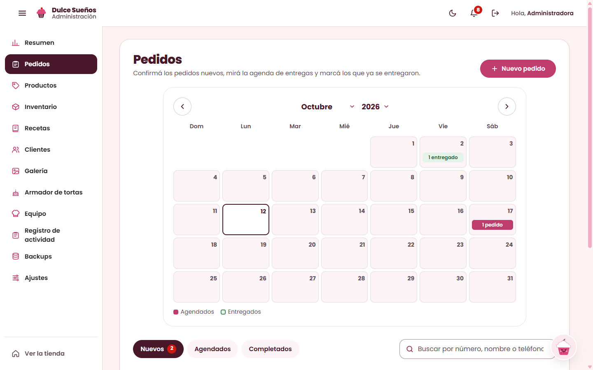
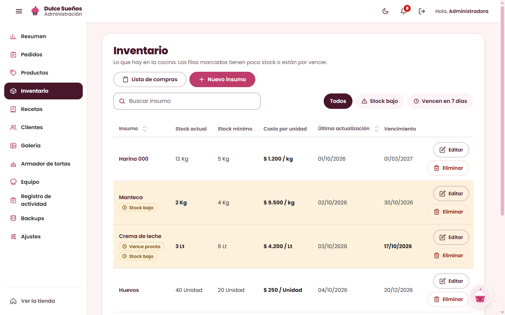
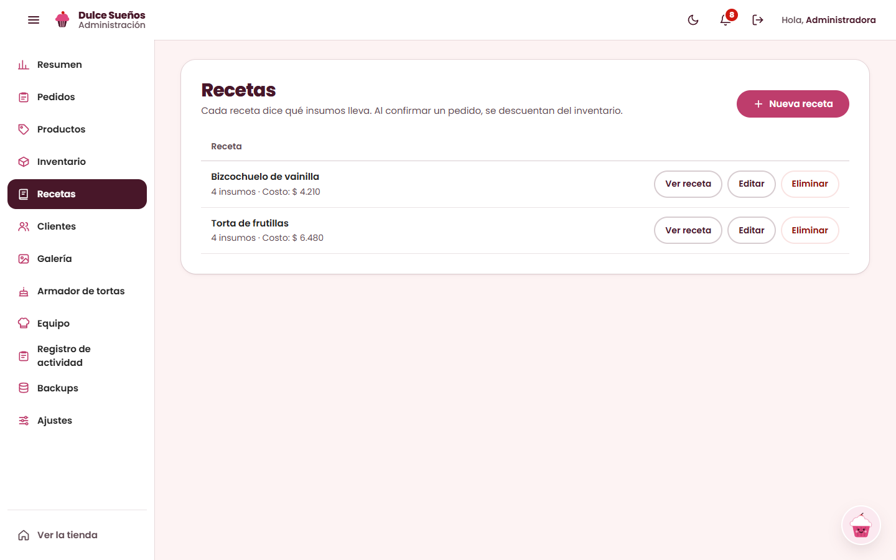
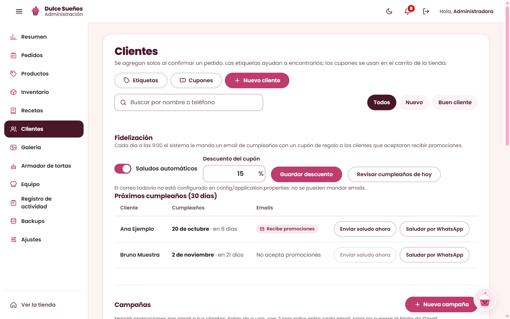
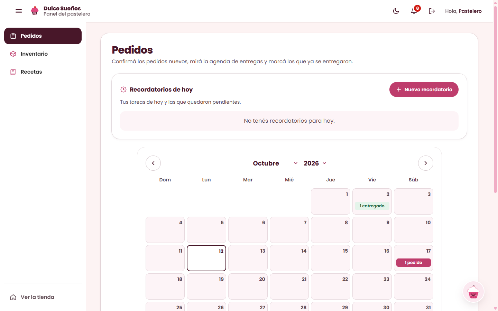
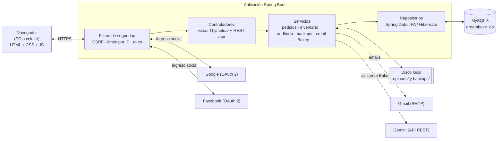

<p align="center">
  
</p>

<h1 align="center">DreamBake</h1>

<p align="center">
  Sistema web de gestión para la pastelería <strong>Dulce Sueños Posadas</strong>:<br>
  tienda online, pedidos, inventario, recetas, clientes y un asistente de IA, accesible desde PC y celular.
</p>

> **Documentación técnica** (arquitectura, archivo por archivo, modelo de datos, seguridad y limitaciones): [docs/DOCUMENTACION-TECNICA.md](docs/DOCUMENTACION-TECNICA.md).

> **Estado: beta de prueba (versión 0.0.1-SNAPSHOT).** Las funcionalidades descritas abajo están implementadas, pero el sistema todavía no pasó por pruebas automáticas ni por una auditoría de seguridad completa, y no está endurecido para producción. Ver [Estado del proyecto y trabajo pendiente](#11-estado-del-proyecto-y-trabajo-pendiente).

## Índice

1. [Qué es DreamBake](#1-qué-es-dreambake)
2. [Contexto](#2-contexto)
3. [Funcionalidades](#3-funcionalidades)
4. [Tecnologías](#4-tecnologías)
5. [Arquitectura](#5-arquitectura)
6. [Requisitos e instalación en Windows](#6-requisitos-e-instalación-en-windows)
7. [Configuración de servicios externos](#7-configuración-de-servicios-externos)
8. [Roles y permisos](#8-roles-y-permisos)
9. [Seguridad, backups y auditoría](#9-seguridad-backups-y-auditoría)
10. [Cómo se publica hoy](#10-cómo-se-publica-hoy)
11. [Estado del proyecto y trabajo pendiente](#11-estado-del-proyecto-y-trabajo-pendiente)
12. [Autor, institución y licencia](#12-autor-institución-y-licencia)

## 1. Qué es DreamBake

DreamBake es un sistema web de gestión para **Dulce Sueños Posadas**, un emprendimiento de Posadas (Misiones) que elabora tortas personalizadas y mesas dulces. Reúne en una sola aplicación la tienda para los clientes y los paneles de trabajo de la dueña y del pastelero. Está pensado para personal no técnico: todo funciona desde el navegador, sin instalar nada, tanto en PC como en celular.

| Tienda pública | Panel de administración |
|---|---|
|  |  |

> Las capturas de este documento se tomaron con una base de datos de ejemplo (nombres, teléfonos y pedidos ficticios) y fotos de muestra.

## 2. Contexto

Según el relevamiento hecho en cuatro entrevistas con la dueña, la información del negocio estaba dispersa: los pedidos en un pizarrón, los clientes en WhatsApp e Instagram y las finanzas en un cuaderno. No había control de inventario ni de vencimientos de insumos, las recetas y el cálculo de insumos se hacían sin fórmula, y la producción de los pedidos grandes (decoraciones, bizcochuelos y galletitas con días de anticipación distintos) se coordinaba de memoria. Cuando un pedido salía mal se perdía todo lo utilizado, y se dedicaban entre 4 y 5 horas semanales a tareas administrativas automatizables.

DreamBake responde a eso con un único lugar donde se cargan y siguen los pedidos (con calendario de entregas), un inventario con alertas de stock bajo y de vencimientos, recetas que descuentan los insumos al confirmar un pedido, una ficha de clientes con cupones y recordatorios de cumpleaños, y un registro de toda la actividad. El requisito principal de la clienta fue la simplicidad: si el sistema es complicado, el personal prefiere volver al papel; por eso las pantallas son directas y adaptables a celular.

## 3. Funcionalidades

Solo se listan funciones que existen en el código. Cuando algo no se probó contra el servicio real, se aclara.

### Tienda pública y cuentas de clientes

- **Catálogo de productos** por categorías con buscador, y **armador de tortas** paso a paso (tamaño, bizcochuelo, rellenos, detalles) con precio al instante. El precio final **lo calcula el servidor**.
- **Carrito y pedido** con fecha de entrega, retiro o envío, cupón de descuento y mensaje de WhatsApp con el código de seguimiento. Avisa si los pedidos están pausados o si la fecha no respeta la anticipación mínima.
- **Seguimiento de pedidos** por código (`/seguimiento`): línea de tiempo recibido → confirmado → en preparación → listo, sin datos personales completos.
- **Registro e ingreso** con email y contraseña; **recuperación de contraseña** por email; ingreso con **Google** y **Facebook** (ver aclaración abajo); perfil con "Mis pedidos", cumpleaños, consentimiento de promociones y **eliminación de la cuenta**.
- Páginas de **privacidad, términos y eliminación de datos**, aviso de cookies y baja de emails con un clic. Las páginas legales todavía tienen marcadores `[COMPLETAR: …]` (razón social, CUIT, plazos) que hay que llenar antes de publicar con datos reales.

| Productos | Armador de tortas |
|---|---|
|  |  |

### Panel de administración (rol Administrador)

| Módulo | Qué hace |
|---|---|
| **Resumen** | Facturación, saldo por cobrar, pedidos del mes, próximas entregas, alertas de stock, gráficos (Chart.js) y ganancia estimada cuando todos los productos del pedido tienen receta con costo. Descarga de informe. |
| **Pedidos** | Calendario de entregas y listas Nuevos / Agendados / Completados. Confirmar (verifica stock y **descuenta los insumos**), rechazar, editar, cargar pedidos manuales, ver detalle e imprimir recibo (sin valor legal). |
| **Productos y galería** | Alta y edición de productos y categorías; galería de fotos con subida validada (JPG/PNG/WebP, máximo 5 MB, se achican y se les borra el EXIF). |
| **Inventario** | Insumos con stock actual y mínimo, costo por unidad y vencimiento; filtros "Stock bajo" y "Vencen en 7 días"; lista de compras. |
| **Recetas** | Cada receta indica qué insumos lleva; calcula su costo. |
| **Clientes y fidelización** | Ficha automática al confirmar un pedido, etiquetas, **cupones** (descuento, envío gratis, regalo), **cumpleaños** con cupón automático y **campañas de promociones por email** con vista previa y tope diario. |
| **Armador de tortas** | Configura tamaños, precios, bizcochuelos y rellenos del armador público. |
| **Equipo** | Alta, baja y roles de usuarios del personal. |
| **Recordatorios y tareas** | Recordatorios propios (con aviso por email 1 hora antes si hay correo configurado) y campanita de avisos: pedidos nuevos, stock mínimo, vencimientos, entregas de mañana. |
| **Registro de actividad** | Toda acción que modifica datos queda registrada (ver sección 9). Filtros, detalle, CSV/PDF y verificación de integridad. |
| **Backups** | Estado, lista, descarga, copia manual y restauración (ver sección 9). |
| **Ajustes** | Datos del negocio (nombre, WhatsApp, horario, anticipación mínima, seña sugerida, pausa de pedidos) y cuenta de correo de envío. |
| **Bakey (asistente de IA)** | Chat dentro de los paneles que consulta pedidos, stock, clientes y ventas, y **propone** acciones (crear pedido, cambiar estado, ajustar stock, crear recordatorio) que solo se ejecutan si la persona las confirma. Usa la API de Gemini. Más detalles en [docs/BAKEY.md](docs/BAKEY.md). |

| Pedidos | Inventario |
|---|---|
|  |  |

| Recetas | Clientes y fidelización |
|---|---|
|  |  |

### Panel del pastelero (rol Pastelero)

Versión reducida para quien produce: **Pedidos** (confirmar, marcar entregado, volver a agendado, crear pedidos sin montos), **Inventario** y **Recetas**, más recordatorios, avisos y Bakey. El servidor no le envía montos, señas, precios ni costos (solo el administrador los ve), y no puede cambiarlos.



### Qué está probado y qué no

- **Correo (Gmail/SMTP):** implementado (recuperar contraseña, avisos de pedido, cumpleaños, campañas, alertas de backup), pero probado únicamente contra un servidor SMTP simulado. **Todavía no se envió ningún email real.**
- **Ingreso con Google y Facebook:** implementado y probado solo con proveedores simulados. Sin credenciales cargadas, los botones no aparecen y el resto del sistema funciona igual.
- **Cumpleaños automáticos:** requieren correo configurado; vienen activables desde Clientes → Fidelización.
- **Backups:** quedan desactivados hasta configurar la carpeta de destino y la ruta de `mysqldump` (ver sección 6). La restauración se probó en bases de prueba.
- **Costos y márgenes:** existen el costo por insumo y por receta, pero **no hay todavía un reporte de márgenes**. Las tortas del armador no tienen receta: no descuentan insumos ni entran en la ganancia estimada.

## 4. Tecnologías

Versiones leídas de `pom.xml` y resueltas con `mvnw dependency:list`.

| Componente | Versión |
|---|---|
| Java | 21 (definido en `pom.xml`) |
| Spring Boot | 4.0.6 (Spring Framework 7.0.7, Spring Security 7.0.5, Tomcat embebido 11.0.21) |
| Hibernate ORM (vía Spring Data JPA) | 7.2.12.Final |
| MySQL Server | 8.0 (probado con 8.0.46) |
| MySQL Connector/J | 9.7.0 |
| Thymeleaf / `thymeleaf-extras-springsecurity6` | 3.1.5.RELEASE / 3.1.5.RELEASE |
| Lombok | 1.18.46 |
| OpenPDF (informes y registro en PDF) | 3.0.5 |
| Jackson | 3.1.2 |
| AspectJ Weaver | 1.9.25.1 |
| Jakarta Mail API / Angus Mail | 2.1.5 / 2.0.5 |
| Maven (wrapper `mvnw`) | 3.9.16 |

Starters de Spring Boot 4.0.6 usados: `data-jpa`, `security`, `thymeleaf`, `validation`, `webmvc`, `mail`, `security-oauth2-client`, `aspectj`, `actuator` (solo `/actuator/health`) y `devtools` (solo desarrollo).
Dependencia de pruebas: `com.microsoft.playwright:playwright` 1.63.0, reservada para las pruebas de navegador que quedan pendientes (sección 11), más los starters `*-test` de Spring Boot.

**Frontend:** HTML, CSS y JavaScript sin frameworks ni paso de compilación (no usa npm). Tipografía Poppins (Google Fonts) y Chart.js cargado por CDN en los paneles (sin versión fija todavía).

## 5. Arquitectura

Aplicación monolítica de Spring MVC: las vistas se renderizan en el servidor con Thymeleaf y los paneles consumen una API REST bajo `/api` con `fetch`.



Estructura del código (`src/main/java/com/dreambake/`): `config/` (seguridad, MVC, tareas programadas), `controller/` (vistas y REST), `service/` (lógica de negocio), `repository/`, `entity/` (entidades JPA y enumeraciones), `audit/` (registro de actividad) y `ai/` (Bakey, con una interfaz `AiProvider` y la implementación para Gemini). Las tablas las crea y actualiza Hibernate (`ddl-auto=update`); no hay scripts SQL ni migraciones.

## 6. Requisitos e instalación en Windows

**Requisitos**

- **Java 21** (JDK). Comprobalo con `java -version`.
- **MySQL 8.0** corriendo en `localhost:3306`.
- Maven **no** hace falta: se usa el wrapper incluido (`mvnw.cmd`).
- Para los backups: `mysqldump.exe` y `mysql.exe`, que vienen con MySQL Server.

**Pasos**

1. **Clonar el repositorio** y entrar a la carpeta:

   ```powershell
   git clone https://github.com/NatanielFM/DreamBake.git
   cd DreamBake
   ```

2. **Crear la base de datos** (desde MySQL Command Line Client o `mysql -u root -p`):

   ```sql
   CREATE DATABASE dreambake_db;
   ```

   Se recomienda usar un usuario propio de MySQL en lugar de `root` (ver sección 11).

3. **Crear el archivo de configuración local** a partir del ejemplo:

   ```powershell
   Copy-Item config\application.ejemplo.properties config\application.properties
   ```

   `config/application.properties` **no se sube a Git** (está en `.gitignore`). Abrilo y completá, como mínimo, la conexión a la base: descomentá y completá `spring.datasource.url`, `spring.datasource.username` y `spring.datasource.password` con tus datos de MySQL. Esos valores pisan a los de `src/main/resources/application.properties`. El resto de las claves (correo, Google, Facebook, Gemini, backups) son opcionales: una clave vacía solo desactiva su función y la app lo avisa en el log al arrancar.

4. **Ejecutar la aplicación** desde la carpeta del proyecto (la que contiene `config/`):

   ```powershell
   .\mvnw.cmd spring-boot:run
   ```

   Abrí <http://localhost:8080>. Para compilar sin levantar: `.\mvnw.cmd compile`.

5. **Crear el primer administrador.** No hay usuarios precargados. Registrate desde <http://localhost:8080/register> y después, en MySQL, dale el rol:

   ```sql
   USE dreambake_db;
   UPDATE users SET roles='ADMIN' WHERE email='tu-email@ejemplo.com';
   ```

   Para un pastelero, usá `roles='PASTELERO'`. Al volver a ingresar, el administrador va a `/admin` y el pastelero a `/baker`. Desde Panel → Equipo se pueden gestionar los demás usuarios.

6. **(Opcional) Activar los backups** en `config/application.properties`: `backup.directory` (carpeta de destino, con `/` en lugar de `\`) y `backup.mysqldump-path` (por ejemplo `C:/Program Files/MySQL/MySQL Server 8.0/bin/mysqldump.exe`). Sin esto, los backups quedan desactivados y el Resumen del panel muestra un aviso en rojo.

## 7. Configuración de servicios externos

Todas las claves van en `config/application.properties` (nunca en Git). El archivo de ejemplo `config/application.ejemplo.properties` explica cada una. Las líneas de correo, Google y Facebook vienen **comentadas** a propósito: si se activan con valor vacío, la aplicación no arranca; descomentalas solo cuando tengas el dato.

| Servicio | Propiedad(es) | De dónde se saca |
|---|---|---|
| **Gmail** (correo saliente) | Lo más simple: cargarlo desde el panel, en **Ajustes → Correo de envío** (se guarda cifrado en la base). Alternativa: `spring.mail.host`, `spring.mail.port`, `spring.mail.username`, `spring.mail.password` y las `spring.mail.properties.mail.smtp.*` del ejemplo. | Cuenta de Gmail con verificación en dos pasos y una **contraseña de aplicación** (Cuenta de Google → Seguridad → Contraseñas de aplicaciones). Host `smtp.gmail.com`, puerto `587`. |
| **Google** (ingreso social) | `spring.security.oauth2.client.registration.google.client-id` y `…client-secret` | Google Cloud Console → APIs y servicios → Credenciales → ID de cliente OAuth (tipo "Aplicación web"). URI de redirección autorizada: `<app.public-url>/login/oauth2/code/google`. |
| **Facebook** (ingreso social) | `spring.security.oauth2.client.registration.facebook.client-id` y `…client-secret` | Facebook for Developers → tu app → Configuración → Básica (identificador y clave secreta). URI de redirección: `<app.public-url>/login/oauth2/code/facebook`. Solo se piden los permisos `email` y `public_profile`. |
| **Gemini** (asistente Bakey) | `bakey.gemini.api-key` (o la variable de entorno `GEMINI_API_KEY`) y `bakey.gemini.model` | Google AI Studio → *Get API key*. Vacía = Bakey queda "no configurado" y el resto anda igual. En el plan gratuito Google puede usar lo enviado para mejorar sus productos y hay límites de uso; por eso a Bakey nunca se le mandan datos personales completos de clientes. |
| **Dirección pública** | `app.public-url` | La URL con la que se accede al sitio (se usa en los links de los emails y en los redireccionamientos OAuth). Sin `/` final. |

> Por seguridad, no subas a Git ni compartas `config/application.properties` ni `config/secret.key` (la clave que cifra la contraseña del correo; también viaja dentro de cada backup).

## 8. Roles y permisos

Definidos en `src/main/java/com/dreambake/config/SecurityConfig.java`. Los roles son *authorities* sin prefijo (`ADMIN`, `PASTELERO`) guardadas como texto en `users.roles`. Un usuario registrado sin ninguno de los dos roles es un **cliente**.

| Rol | Puede hacer |
|---|---|
| **Visitante** (sin sesión) | Ver la tienda, productos y armador (`/`, `/products`, `/builder`, `/cart`); crear pedidos (`POST /api/orders`); validar cupones; seguir un pedido por código (`/seguimiento`); registrarse, iniciar sesión y recuperar la contraseña; ver las páginas legales y darse de baja de los emails. |
| **Cliente** (sesión sin rol de personal) | Todo lo anterior, más su perfil (`/profile`) y sus datos y pedidos (`/api/account/**`, siempre los de su propia sesión): cambiar datos, cumpleaños y consentimiento, vincular Google y eliminar su cuenta. |
| **Pastelero** (`PASTELERO`) | Panel `/baker`. **Lee** pedidos, insumos, recetas y productos (sin montos: el servidor los quita de las respuestas). **Escribe** solo lo que su panel le permite: crear pedidos (quedan en $ 0), confirmar, marcar Entregado y volver a agendar, sus recordatorios y Bakey. No puede rechazar ni cancelar ni eliminar pedidos, ni editar un pedido ya cargado, ni crear, editar o borrar insumos, recetas o productos, ni ver estadísticas de facturación: el servidor responde 403. Con Bakey tiene las mismas reglas. |
| **Administrador** (`ADMIN`) | Panel `/admin` y todo el resto de `/api/**`: usuarios, clientes, cupones, campañas, fidelización, galería, productos, armador, ajustes, registro de actividad, backups y restauración, estadísticas, y todas las escrituras de pedidos, insumos y recetas (editar, rechazar, cancelar, eliminar), además de lo que puede el pastelero. |

Después de iniciar sesión: ADMIN → `/admin`, PASTELERO → `/baker`, otro → `/`. Cualquier ruta no listada exige estar autenticado.

## 9. Seguridad, backups y auditoría

**Seguridad.** Las contraseñas se guardan con BCrypt. La protección CSRF está activada en toda la aplicación (el token viaja en la cookie `XSRF-TOKEN` y lo agrega `static/js/csrf.js` en cada `fetch`). Se envían los encabezados `Content-Security-Policy` (que no permite JavaScript dentro del HTML), `X-Frame-Options: DENY` y `Referrer-Policy`, y la cookie de sesión usa `SameSite=Lax`. Tras 5 intentos de inicio de sesión fallidos, la cuenta se bloquea 15 minutos. Un filtro limita por IP los pedidos (10), cupones (30), registros (10), intentos de login (20) y pedidos de recuperación de contraseña (10) en ventanas de 10 minutos. Los montos del negocio (totales, señas, precios, costos) solo los recibe el ADMIN: al pastelero el servidor se los quita de las respuestas, no por CSS. El precio de un pedido de la tienda **lo calcula el servidor** a partir de la base: el total que mande el navegador se ignora. Los textos de los pedidos públicos se sanean, las subidas de imágenes se validan por su contenido real, los links de recuperación de contraseña vencen a los 30 minutos y sirven una sola vez (solo se guarda su huella SHA-256), y las páginas de error no muestran detalles internos. El perfil de producción (`application-prod.properties`) toma las claves de variables de entorno y activa cookies `Secure`, pero **no se usó todavía en un despliegue real** (ver sección 11).

**Backups.** Una vez configurados (sección 6), se hace un backup todos los días a las 3:00 (y otro a los 2 minutos de arrancar si el último bueno tiene más de 24 horas). Cada backup es un `.zip` con la base (volcado `mysqldump` comprimido), la carpeta `uploads/` y `config/secret.key`, acompañado de un `.sha256` para verificar que no se dañó. Se guardan por niveles: 7 diarios, 4 semanales, 12 mensuales y 10 manuales; los viejos se borran solo si el nuevo salió bien. Si un backup falla, se avisa por email a los administradores, y el Resumen muestra un aviso rojo si pasaron más de 48 horas sin un backup bueno. Desde el panel se puede descargar, hacer uno manual y **restaurar** (pide tilde, la palabra RESTAURAR y la contraseña; verifica la huella, prueba la restauración en una base aparte, hace una copia previa y recién entonces reemplaza los datos). Los backups son **solo locales**: no hay copia automática fuera de la PC. La guía para quien no es técnico está en [docs/RESTAURAR-BACKUP.md](docs/RESTAURAR-BACKUP.md).

**Auditoría.** Toda acción que crea, edita, borra, cambia un estado o descarga algo queda registrada en la tabla `audit_logs` con quién la hizo, cuándo, desde qué IP y qué cambió, con descripciones en español. El registro es **inmutable**: la entidad es de solo lectura, dos *triggers* de MySQL impiden modificar o borrar filas, y cada registro lleva un hash SHA-256 encadenado con el anterior, de modo que cualquier alteración rompe la cadena. Se verifica automáticamente todos los lunes a las 7:00 y a pedido desde el panel, con aviso por email y en el Resumen si algo no coincide. Los datos personales (teléfono, email, dirección, cumpleaños) se guardan enmascarados, de modo que el registro no contenga datos de clientes que luego pidan eliminarlos (Ley 25.326 de Protección de Datos Personales). Las acciones que hace Bakey quedan marcadas como "vía Bakey".

## 10. Cómo se publica hoy

Durante las pruebas, la aplicación corre en la PC del autor y se expone a internet con **Tailscale Funnel**, que publica el puerto 8080 por HTTPS sin abrir puertos del router. La aplicación reconoce el proxy de forma segura (solo confía en los encabezados `X-Forwarded-*` si la conexión viene de la propia PC). No hay un servidor dedicado, ni dominio propio, ni arranque automático de la aplicación.

## 11. Estado del proyecto y trabajo pendiente

Esta versión es una **beta de prueba**: el sistema está completo en lo funcional, pero dos bloques de trabajo quedan **pospuestos** hasta que se requieran.

**a) Pruebas automáticas y auditoría de seguridad completa**

- Hoy existe un único test (`DreambakeApplicationTests`, que verifica que la aplicación arranca). No hay pruebas automáticas de servicios, permisos, precios, stock ni auditoría, ni pruebas de navegador (la dependencia Playwright está declarada pero sin uso).
- Se hicieron revisiones de seguridad puntuales y pruebas manuales durante el desarrollo, pero **no una auditoría completa** (por ejemplo, contra el OWASP Top 10) ni una revisión de vulnerabilidades en las dependencias.
- Tampoco hubo una prueba manual de punta a punta con la dueña de la pastelería.

**b) Endurecimiento para producción**

- Usar un **usuario de MySQL con permisos mínimos** en lugar de `root` (que es lo que se usa hoy en desarrollo).
- Ejecutar la aplicación como **servicio de Windows** con arranque automático (hoy hay que iniciarla a mano).
- **Dominio propio** y dirección pública estable (`app.public-url` es hoy `localhost` por defecto).
- Completar las páginas legales y cargar los datos reales del negocio.

**Otras limitaciones conocidas**

- No se envió ningún correo real ni se probó el ingreso con Google/Facebook contra los proveedores reales (ver sección 3).
- No hay reporte de márgenes y las tortas del armador no descuentan insumos.
- Los backups son solo locales.
- Chart.js se carga desde un CDN sin versión fija.

## 12. Autor, institución y licencia

**Autor:** Nataniel Medina.
**Institución:** IPESMI — Técnico Superior en Analista de Sistemas, Posadas, Misiones, 2026.
Trabajo final de la carrera.

**Licencia:** este repositorio **no incluye un archivo de licencia**. Mientras no se defina una, todos los derechos quedan reservados por el autor.
