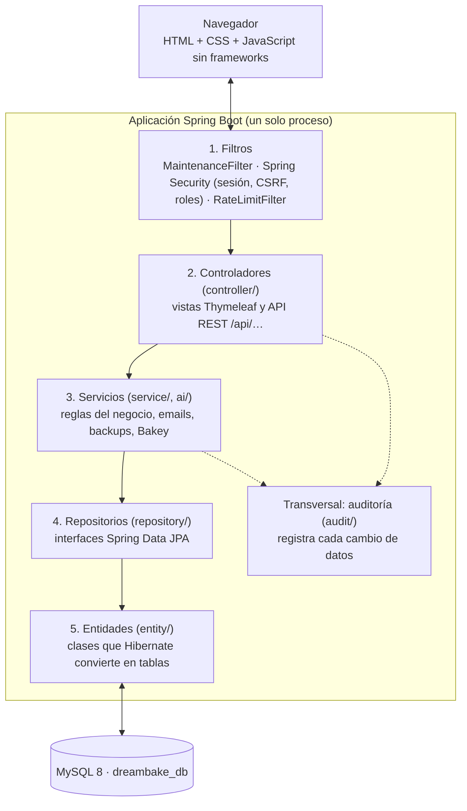
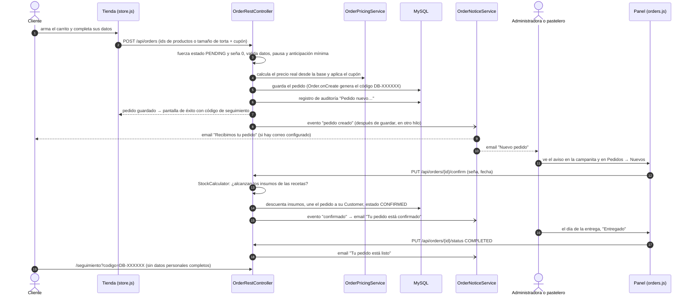

# 1. Arquitectura general

[← Volver al índice](../DOCUMENTACION-TECNICA.md)

DreamBake es una **aplicación monolítica**: un solo programa Java (Spring Boot) que atiende las páginas, la API y las tareas automáticas, conectado a una base MySQL. No hay microservicios ni un frontend separado.

## 1.1 Las capas

Cada pedido que llega del navegador atraviesa siempre las mismas capas, de afuera hacia adentro:

| Capa | Paquete | Responsabilidad | Ejemplo |
|---|---|---|---|
| Filtros | `config/` | Revisar cada pedido HTTP antes de que llegue a un controlador: modo mantenimiento, sesión, token CSRF, permisos por rol, límite de pedidos por IP. | `SecurityConfig`, `RateLimitFilter`, `MaintenanceFilter` |
| Controladores | `controller/` | Recibir el pedido HTTP, validar los datos de entrada y devolver una página (Thymeleaf) o JSON (`ResponseEntity`). | `OrderRestController`, `WebController` |
| Servicios | `service/`, `ai/` | Lógica del negocio que no es de una sola pantalla: calcular precios, mandar emails, hacer backups, cifrar, calcular avisos. | `OrderPricingService`, `BackupService`, `BakeyService` |
| Repositorios | `repository/` | Leer y guardar en la base. Son interfaces: Spring Data JPA escribe el SQL a partir del nombre del método (`findByEmail`, `findFirstByPhone`). | `OrderRepository` |
| Entidades | `entity/` | Clases Java que representan las tablas. Hibernate crea y actualiza las tablas solo a partir de ellas (`ddl-auto=update`). | `Order`, `Product`, `InventoryItem` |

**Una aclaración honesta:** parte de la lógica de negocio quedó en los controladores REST (por ejemplo, confirmar un pedido y descontar insumos está en `OrderRestController`) en lugar de en un servicio. Funciona, pero en un sistema más grande convendría moverla a servicios. Bakey reutiliza esos mismos métodos del controlador para no duplicar la lógica (decisión del autor).

### Dos formas de responder

1. **Páginas (Thymeleaf):** `WebController`, `AdminController`, `BakerController`, `AuthController` y otros devuelven el nombre de una plantilla de `templates/`. El servidor la completa con datos (por ejemplo, el nombre del negocio) y manda HTML.
2. **API REST (`/api/…`):** los controladores `*RestController` devuelven JSON. El JavaScript de los paneles y de la tienda los llama con `fetch` y arma la pantalla en el navegador. Así, el panel de administración es **una sola página con pestañas** (`admin.html`), y cada pestaña tiene su propio archivo JS en `static/js/admin/`.

### Piezas transversales

- **Seguridad** (`config/SecurityConfig`): quién puede entrar a cada ruta. Ver [Seguridad](05-seguridad.md).
- **Auditoría** (`audit/`, `service/AuditService`): cada acción que cambia datos queda registrada, ya sea con la anotación `@Auditable` o con una llamada directa a `auditService.log(...)`.
- **Datos para todas las vistas** (`GlobalControllerAdvice`, `PublicViewAdvice`): el usuario actual, el número de WhatsApp y los datos del negocio quedan disponibles en todas las plantillas.
- **Montos solo para el admin** (`MoneyResponseAdvice`): quita los campos de dinero de las respuestas cuando quien pregunta es el pastelero.

## 1.2 Tareas programadas

Algunas cosas pasan solas, sin que nadie toque un botón. Están en `config/*Scheduler.java` y usan la hora de Argentina (`America/Argentina/Buenos_Aires`).

| Cuándo | Qué hace | Clase |
|---|---|---|
| Todos los días a las 3:00 (y a los 2 min de arrancar si el último backup bueno tiene más de 24 h) | Copia de seguridad de la base, fotos y clave de cifrado. | `BackupScheduler` → `BackupService` |
| Todos los días a las 8:00 (o al arrancar, si ya pasó la hora) | Resumen de entregas de los próximos 3 días para el negocio y recordatorio al cliente el día antes de su entrega. | `OrderNoticeScheduler` → `OrderNoticeService` |
| Todos los días a las 9:00 (o al arrancar) | Saludo de cumpleaños con cupón a los clientes que aceptaron promociones. | `LoyaltyScheduler` → `BirthdayService` |
| Cada 5 minutos | Avanza las campañas de promociones programadas o en curso (respetando el tope diario de emails). | `CampaignScheduler` → `CampaignSender` |
| Cada minuto | Manda el email de los recordatorios del personal que vencen dentro de la hora. | `ReminderScheduler` → `ReminderService` |
| Lunes a las 7:00 | Verifica la cadena de hashes del registro de auditoría y avisa si algo no coincide. | `AuditScheduler` → `AuditIntegrityService` |

Todas las tareas que mandan emails no hacen nada si no hay una cuenta de correo configurada (hoy no la hay: ver [limitaciones](06-limitaciones-y-mejoras.md)).

Además, al arrancar la app corren tareas de mantenimiento de la base: crear los triggers de la auditoría (`AuditDatabaseInitializer`), quitar restricciones viejas de los enums (`EnumCheckSchemaFix`, `EmailLogSchemaFix`) y completar datos faltantes en registros viejos (`TrackingCodeBackfill`, `CustomerConsentBackfill`).

## 1.3 Un pedido de punta a punta

Este es el recorrido completo de un pedido hecho desde la tienda, con las clases que intervienen en cada paso.

Paso a paso, en palabras:

1. **El cliente arma el pedido** en la tienda (`products.html`, `builder.html`, `cart.html`). El carrito se guarda en el navegador (`localStorage`, clave `dreamBakeCart`) y lo maneja `static/js/public/store.js`.
2. **El navegador manda solo lo necesario**: qué productos (por su `id`) o qué tamaño de torta (`cakeSizeId`), el código del cupón y los datos de contacto. **El total que pudiera mandar el navegador se ignora.**
3. **El servidor valida y calcula** (`OrderRestController.createOrder`):
   - si quien pide no es personal, fuerza estado `PENDING`, seña 0 y pedido nuevo;
   - exige nombre, teléfono, fecha e ítems; revisa la pausa de pedidos y la anticipación mínima (`BusinessProfileService.checkStoreOrder`);
   - `OrderPricingService` busca los precios reales en `products` y `cake_sizes`, valida el cupón, le descuenta un uso y calcula el total;
   - limpia los textos con `InputSanitizer` (para que nadie pueda inyectar código en el panel).
4. **Se guarda** el pedido. `Order.onCreate` pone la fecha y genera el **código de seguimiento** `DB-` + 6 caracteres al azar (`TrackingCodes`).
5. **Se audita** ("Pedido nuevo #45 desde la tienda web, por $ 28.000").
6. **Se avisa:** el controlador publica un evento; `OrderNoticeService` lo recibe **después** de que la transacción se confirmó y manda los emails en otro hilo (así un problema con el correo nunca rompe el pedido). La campanita del panel (`NotificationService`) muestra el pedido nuevo.
7. **El personal confirma** el pedido desde el panel. `StockCalculator` suma los insumos que piden las recetas de los productos; si no alcanzan, el panel pregunta si confirmar igual (`force`). Al confirmar:
   - se **descuentan los insumos** del inventario;
   - el pedido se **une a su cliente** (`Customer`): se busca por teléfono y, si no existe, se crea;
   - se guarda la seña (solo si quien confirma es el administrador).
8. **Entrega:** se marca como Entregado (`COMPLETED`). El cliente puede seguir el estado en `/seguimiento` con su código (`TrackingController` + `TrackingService`, 10 búsquedas por minuto por IP).

Estados posibles (`OrderStatus`): `PENDING` (nuevo) → `CONFIRMED` (agendado) → `IN_PROGRESS` (en preparación) → `COMPLETED` (entregado), o `CANCELLED` / `REJECTED`. Nota: ningún botón de los paneles pasa un pedido a `IN_PROGRESS`; el estado existe en el modelo, en el seguimiento y en Bakey, pero en la práctica los pedidos van de agendado a entregado.

El pastelero hace el mismo recorrido desde su panel (`baker.html`) con dos diferencias: no ve ni carga montos, y no puede rechazar, cancelar ni eliminar pedidos (ver [Seguridad](05-seguridad.md#qué-ve-y-qué-puede-hacer-el-pastelero)).
