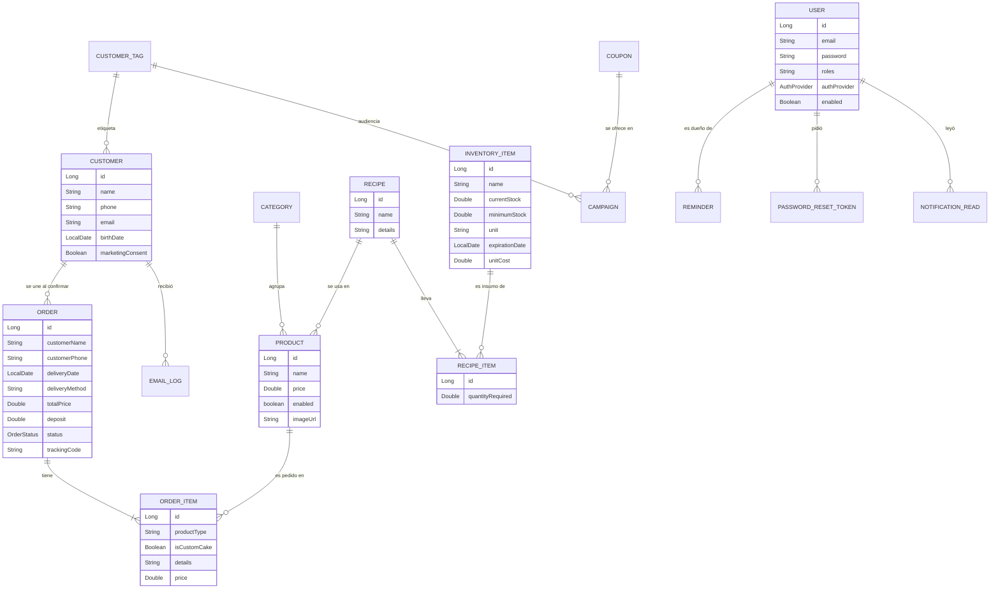
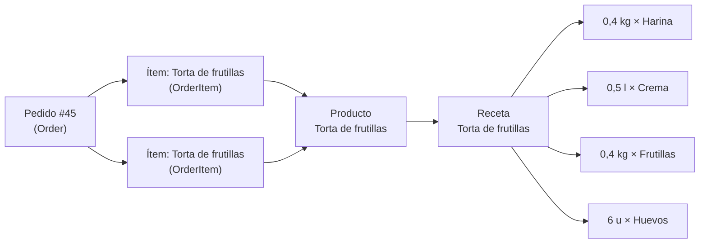

# 4. Modelo de datos

[← Volver al índice](../DOCUMENTACION-TECNICA.md)

Los datos viven en MySQL, en la base `dreambake_db`. **No hay scripts SQL ni migraciones:** las tablas las crea y actualiza Hibernate a partir de las clases del paquete `entity/` (`spring.jpa.hibernate.ddl-auto=update`). Son 23 tablas.

Consecuencias de `ddl-auto=update` que conviene conocer:
- Agregar un campo a una entidad agrega la columna al arrancar. **Renombrar o borrar un campo no limpia la columna vieja**: queda en la base sin uso.
- Hibernate no cambia los tipos de columnas existentes. Por eso los enums se guardan como texto (`VARCHAR`) y dos clases de arranque (`EnumCheckSchemaFix`, `EmailLogSchemaFix`) quitan restricciones viejas para poder agregar valores nuevos.
- Antes de tocar una entidad hay que hacer un backup: el cambio altera la base real.

## 4.1 Diagrama entidad-relación

Se muestran las entidades del negocio con sus relaciones (las tablas técnicas, sin relaciones con estas, están en la tabla de 4.2).

## 4.2 Entidades

**Pedidos y catálogo**
| Entidad (tabla) | Datos principales | Relaciones |
|---|---|---|
| `Order` (`orders_table`) | Nombre, teléfono y email del cliente (como texto), fecha y turno de entrega, retiro o envío y dirección, cupón usado, cumpleaños y consentimiento del checkout, `totalPrice`, `deposit` (seña), `status`, `createdAt`, `trackingCode` (único, `DB-XXXXXX`, no se modifica). `stockStatus` se calcula al leer (no es columna). | 1–N `OrderItem` (se borran con el pedido); N–1 `Customer` (se completa al confirmar). |
| `OrderItem` (`order_items`) | Nombre del producto, si es torta del armador, detalles (texto largo), precio. **Cada ítem es una unidad** (3 alfajores = 3 ítems). `cakeSizeId` solo viaja desde la tienda (no se guarda). | N–1 `Order`; N–1 `Product` (vacío si es torta del armador). |
| `Product` (`products`) | Nombre, descripción, precio, habilitado, foto. | N–1 `Category`; N–1 `Recipe` (opcional). |
| `Category` (`categories`) | Nombre, si se puede borrar, orden. | 1–N `Product`. |
| `CakeSize` (`cake_sizes`) | Tamaño del armador: nombre, precio, cantidad máxima de rellenos, si admite bizcochuelo mixto, habilitado. | — |
| `CakeOption` (`cake_options`) | Opción del armador: nombre y categoría (bizcochuelo, crema, fondant), habilitada. | — |
| `GalleryImage` (`gallery_images`) | Dirección de la foto y fecha de subida. | — |

**Producción**
| Entidad (tabla) | Datos principales | Relaciones |
|---|---|---|
| `Recipe` (`recipes`) | Nombre, preparación (texto). El **costo estimado** se calcula al leer (`getEstimatedCost`, `isCostComplete`), no es columna. | 1–N `RecipeItem` (se borran con la receta). |
| `RecipeItem` (`recipe_items`) | Cantidad necesaria. | N–1 `Recipe`; N–1 `InventoryItem`. |
| `InventoryItem` (`inventory_items`) | Nombre, stock actual y mínimo, unidad, vencimiento, costo de una unidad, fecha de la última actualización. | 1–N `RecipeItem`. |

**Clientes y fidelización**
| Entidad (tabla) | Datos principales | Relaciones |
|---|---|---|
| `Customer` (`customers`) | Nombre, email, teléfono, dirección, cumpleaños, fecha de alta, consentimiento de promociones y su fecha, código de baja. `ordersCount` y `totalSpent` se calculan al leer. `totalPurchases` existe pero no se usa. | N–1 `CustomerTag`; 1–N `Order`, `EmailLog`. |
| `CustomerTag` (`customer_tags`) | Nombre, si se puede borrar, orden. | 1–N `Customer`, `Campaign`. |
| `Coupon` (`coupons`) | Código (único), tipo, activo, descripción, porcentaje, texto, límite de usos o ilimitado, vencimiento. | 1–N `Campaign`. |
| `Campaign` (`campaigns`) | Nombre, asunto, título, texto, foto, botón, audiencia, estado, programación y contadores de envío. | N–1 `CustomerTag`, `Coupon` (opcionales). |
| `EmailLog` (`email_logs`) | Destinatario, tipo, asunto, estado, error, fecha; id de campaña y de pedido. Sirve para no repetir avisos. | N–1 `Customer` (opcional). |

**Usuarios, sistema y auditoría**
| Entidad (tabla) | Datos principales | Relaciones |
|---|---|---|
| `User` (`users`) | Email (único, es el usuario de login), contraseña (BCrypt), nombre, teléfono, **roles como texto**, habilitado, proveedor (LOCAL/GOOGLE/FACEBOOK) e id en esa red, foto, email verificado, último ingreso. | 1–N `Reminder`, `PasswordResetToken`, `NotificationRead` (se borran con el usuario). |
| `PasswordResetToken` (`password_reset_tokens`) | **Huella SHA-256** del código (nunca el código), creación, vencimiento (30 min), usado. | N–1 `User`. |
| `NotificationRead` (`notification_reads`) | Qué aviso de la campanita leyó cada persona (clave única por persona). | N–1 `User`. |
| `Reminder` (`reminders`) | Título, notas, fecha y hora, pedido relacionado (solo el número), hecho, creado por Bakey, email enviado. | N–1 `User` (dueño). |
| `BusinessProfile` (`business_profile`) | **Una sola fila:** nombre, WhatsApp, email, dirección, redes, horario, anticipación mínima, seña sugerida, mensaje de la tienda, pausa de pedidos. | — |
| `BusinessSetting` (`business_settings`) | Pares clave/valor de ajustes técnicos (cuenta de correo cifrada, cumpleaños, tope de campañas, avisos de auditoría). | — |
| `BackupRecord` (`backup_records`) | Archivo, tipo, estado, tamaño, huella SHA-256, error, duración, fecha. | — |
| `AuditLog` (`audit_logs`) | Fecha, quién (email, nombre, rol), acción, módulo, entidad, descripción, detalles (JSON, con datos personales enmascarados), IP, navegador, **hash anterior y hash propio**. **Inmutable.** | — |

**Listas de valores (enums, guardados como texto)**
| Enum | Valores |
|---|---|
| `OrderStatus` | `PENDING` (nuevo) → `CONFIRMED` (agendado) → `IN_PROGRESS` (en preparación) → `COMPLETED` (entregado); `CANCELLED`, `REJECTED` |
| `CouponType` | `DESCUENTO`, `ENVIO_GRATIS`, `REGALO`, `OTROS` |
| `AuthProvider` | `LOCAL`, `GOOGLE`, `FACEBOOK` |
| `CampaignAudience` / `CampaignStatus` | `ALL_CONSENTED`, `TAG`, `BIRTHDAY_THIS_MONTH`, `INACTIVE_90_DAYS` / `DRAFT`, `SCHEDULED`, `SENDING`, `SENT`, `CANCELLED` |
| `EmailType` / `EmailStatus` | 16 tipos de email (cumpleaños, promoción, avisos de pedido, recuperar contraseña, alertas…) / `SENT`, `FAILED` |
| `BackupType` / `BackupStatus` | `DAILY`, `WEEKLY`, `MONTHLY`, `MANUAL`, `PRE_RESTORE` / `OK`, `FAILED` |
| `AuditAction` / `AuditModule` | 14 acciones (crear, editar, borrar, cambio de estado, login, descarga, backup, restauración, acción de Bakey…) / 14 módulos (pedidos, productos, inventario, recetas, clientes, cupones, galería, equipo, armador, fidelización, sistema, seguridad, Bakey, recordatorios) |

## 4.3 La cadena clave: Pedido → Ítem → Producto → Receta → Ítem de receta → Insumo

Es la relación que conecta las ventas con la producción y el inventario: **saber qué hay que usar para cada pedido** y descontarlo solo.

**Ejemplo con números** (datos de ejemplo, como los de las capturas del README). La receta "Torta de frutillas" lleva:

| Insumo | Cantidad por torta | Costo por unidad | Costo en la receta |
|---|---|---|---|
| Harina | 0,4 kg | $ 1.200 / kg | $ 480 |
| Crema de leche | 0,5 l | $ 4.200 / l | $ 2.100 |
| Frutillas | 0,4 kg | $ 6.000 / kg | $ 2.400 |
| Huevos | 6 u | $ 250 / u | $ 1.500 |
| **Costo estimado de la receta** | | | **$ 6.480** |

- El **costo** lo calcula `Recipe.getEstimatedCost()` sumando cantidad × costo por unidad. Si algún insumo no tiene costo cargado, `isCostComplete()` da falso y el panel muestra "Costo parcial".
- Un pedido con **2 tortas de frutillas** tiene 2 ítems. Al confirmarlo, `StockCalculator.requiredFor` suma la receta una vez por ítem: 0,8 kg de harina, 1 l de crema, 0,8 kg de frutillas y 12 huevos.
- Antes de confirmar se compara con el stock **utilizable** (`StockCalculator.usableStock`: un insumo vencido cuenta como 0). Si no alcanza, el panel pregunta si confirmar igual.
- Al confirmar (`OrderRestController.deductInventory`) se descuenta cada insumo; si el resultado da negativo queda en 0. El antes y el después de cada insumo quedan en la auditoría.
- El Resumen calcula una **ganancia estimada** (precio de venta − costo de las recetas) solo en los pedidos donde todos los productos tienen receta con costo completo.

## 4.4 Limitaciones conocidas del modelo

Son decisiones pendientes de la tesis; no se cambiaron a propósito.
- **Datos repetidos en `Order`:** el pedido guarda nombre, teléfono y email como texto, además de la relación con `Customer`. Los pedidos viejos se asocian por teléfono, y el cliente recién se une al confirmar.
- **Las tortas del armador no tienen receta:** no descuentan insumos ni entran en la ganancia estimada. Tampoco los pedidos cargados con texto libre.
- **Los roles son un texto en `User`** (`ADMIN`, `PASTELERO`, o el rol de cliente), no una tabla de roles.
- **`IN_PROGRESS` no lo pone ningún botón** de los paneles: existe en el modelo, en el seguimiento y en Bakey, pero en la práctica los pedidos pasan de agendado a entregado.
- **No hay reporte de márgenes** por producto o período (solo la ganancia estimada del Resumen).
- **`Customer.totalPurchases`** quedó sin uso (el total se calcula al leer).
